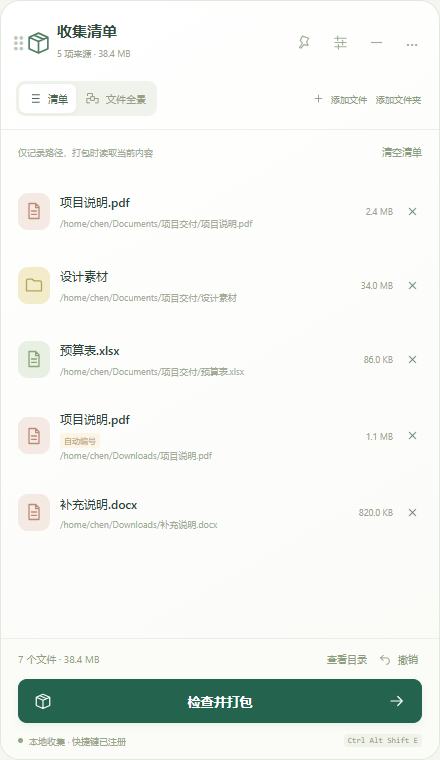

<p align="center">
  
</p>

# GatherPack

[简体中文](README.md) | **English**

[](https://github.com/dogchenya/GatherPack/actions/workflows/prototype.yml)
[](LICENSE)

**Collect scattered files. Pack them together.**

GatherPack is a desktop file collection and archiving tool for Windows, macOS, and Linux. Drop files and folders from different locations into a floating collection bar, organize the list, and export a ZIP, 7z, or tar.gz archive. Everything runs locally, without an account or network connection.

On first launch, GatherPack imports the collection, settings, and reports from an existing easy_pack profile while keeping the original data. If you use launch at login, re-enable it in Settings after migration. On macOS, grant Finder Automation permission when prompted.



*Production frontend with sample files. The application currently uses Simplified Chinese.*

The redesigned shelf adds undo, source relinking, window pinning, and continued collection during packing. See [UI and interaction notes](docs/ui-redesign.md).

## Features

- **Collect across folders**: drag in files or entire folders, or capture the file manager's selection with a keyboard shortcut.
- **Floating collection bar**: drag the whole compact icon or the expanded panel header, and open it whenever you need to manage your list.
- **Three archive formats**: ZIP, 7z, and tar.gz, with a saved default and an override for individual tasks.
- **Preview before packing**: review the archive structure, renamed entries, and unavailable sources before starting.
- **File relationship graph**: explore folders and files as expanding branches, zoom or pan the canvas, and reveal original locations.
- **Preserve your originals**: collection stores paths; removing entries, clearing the list, or cancelling never deletes or moves source files.
- **Keep organizing**: background packing, progress and cancellation, result reports, and a collection that survives restarts.

Folders retain their structure, hidden contents, and empty directories. Duplicate names receive numbered suffixes. Unsupported entries, such as links, are listed for you to resolve or explicitly skip.

## Download and install

Current version: **0.1.0-alpha.8**. This is an Alpha release candidate, with installers distributed through GitHub Releases. Use this version on Ubuntu 22.04; the alpha.4 Linux packages require GLIBC 2.39 and do not support 22.04.

Open [releases and downloads](https://github.com/dogchenya/GatherPack/releases/tag/v0.1.0-alpha.8), choose your platform under **Assets**, and install the package. No GitHub sign-in is required. Separate platform artifacts remain available in GitHub Actions.

| Platform | Artifact | Installation |
| --- | --- | --- |
| Windows x64 | `gatherpack-x86_64-pc-windows-msvc` | Run the `.exe` installer |
| macOS 14+ · Apple Silicon | `gatherpack-aarch64-apple-darwin` | Open the `.dmg` and drag the app into Applications |
| macOS 14+ · Intel | `gatherpack-x86_64-apple-darwin` | Open the `.dmg` and drag the app into Applications |
| Linux x86_64 · Ubuntu 22.04 / 24.04 | `gatherpack-linux-x64-deb` | Install the `.deb` |
| Linux x86_64 · AppImage | `gatherpack-linux-x64-appimage` | Make the `.AppImage` executable and run it |

Quit the previous GatherPack version before upgrading the app on Ubuntu. For an unloaded bridge or a `python3-nautilus` message, follow [Nautilus shortcut troubleshooting](docs/nautilus-shortcut.md#english) to install dependencies and restart the background Files process. Alpha.7 distinguishes missing dependencies from an installed but unloaded bridge.

Linux installers, corresponding source, and verification materials are separate downloads. For normal installation, choose either the `.deb` or AppImage. `x64`, `x86_64`, and `amd64` all mean 64-bit Intel/AMD; 32-bit x86 builds are currently unavailable.

Corresponding source is under `gatherpack-linux-x64-corresponding-source` (the `.tar` is about 545.8 MiB). SHA256 checksums, build provenance, and license notices are under `gatherpack-linux-x64-checksums-and-licenses`. When redistributing the AppImage, include `corresponding-source.tar` from the **same download run**.

Installers are unsigned, and the macOS packages are not notarized. Linux shortcut integration has been validated with **GNOME / X11 / Nautilus**; see [Linux integration](docs/development.en.md#linux-integration) for initial setup.

Installers passed native IPC and installation checks on all four targets; the same Linux packages passed desktop and shortcut regression on Ubuntu 22.04 / 24.04 GNOME/X11. See the [latest validation record](docs/nautilus-shortcut.md#alpha7-validation-en) and [floating window and graph notes](docs/desktop-interaction.md) (Chinese). Full file manager interaction on Windows/macOS, Wayland, and other Linux file managers still needs validation. See the [compatibility and validation record](docs/prototype-validation.md) (Chinese).

## Getting started

1. **Collect**: start the app and drop files or folders onto the floating icon. You can also expand the panel and use “添加文件” (Add files) or “添加文件夹” (Add folder).
2. **Organize**: add items from other locations, remove unwanted entries, and inspect the output structure in “目录与问题” (Structure and issues).
3. **Pack**: select “检查并打包” (Review and pack), choose a format, destination, and filename, then resolve any reported issues before starting.
4. **Review**: read the result report or open the output folder. Your source files and collection remain available.

| Shortcut | Action |
| --- | --- |
| Windows / Linux: `Ctrl + Alt + Shift + E` | Collect the foreground file manager's selected items |
| macOS: `Command + Option + Shift + E` | Collect the selected items in Finder |

Use “设置” (Settings) to change the shortcut, default archive format, or launch-at-login option. Shortcut collection does not require copying files and does not read the clipboard.

## Run from source

Built with **Tauri 2 · Rust · React · TypeScript**.

Install Rust **1.98.1**, Node.js **24**, pnpm **11.25.0**, and the [platform dependencies](docs/development.en.md#prerequisites), then run:

```sh
git clone https://github.com/dogchenya/GatherPack.git
cd GatherPack
pnpm install --frozen-lockfile
pnpm desktop:dev
```

See the [development guide](docs/development.en.md) for tests, installer builds, and Linux source builds.

## Contributing

Bug reports, suggestions, and Pull Requests are welcome. Open an [issue](https://github.com/dogchenya/GatherPack/issues) with your OS version, file manager, reproduction steps, and error message when reporting compatibility problems.

- [Development guide](docs/development.en.md)
- [Compatibility and validation record](docs/prototype-validation.md) (Chinese)
- [Third-party components and distribution notes](docs/third-party.md) (Chinese)

## License

Original GatherPack code is available under the [MIT License](LICENSE). Third-party components retain their own licenses; see [third-party notices](docs/THIRD_PARTY_NOTICES.md).
