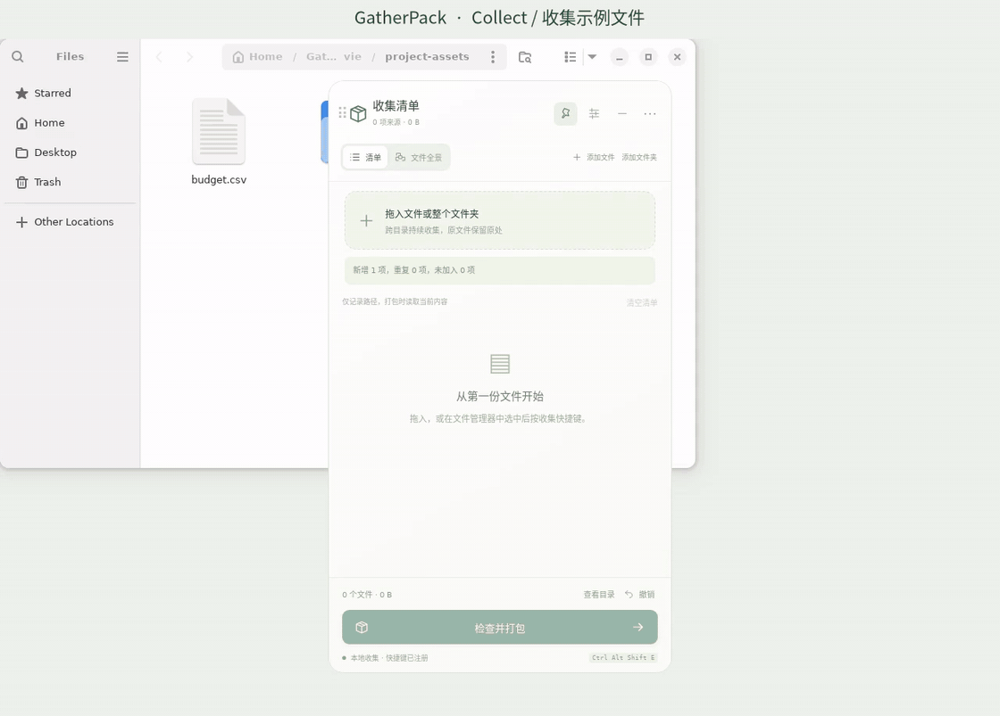

  

# GatherPack

[简体中文](README.md) | **English**

**Collect scattered files. Pack them together.**

A desktop file collection and archiving tool for Windows, macOS, and Linux. Gather files and folders from different locations, organize them in a file graph, and export ZIP, 7z, or tar.gz archives. Everything runs locally, without an account. Original files stay in place.

## See it in action

*Real recording of the current stable app on Ubuntu 24.04 / GNOME X11, using sample files: add files and folders → explore the graph → remove and undo → review and pack → view results.*

[Watch the full-resolution video (MP4)](docs/assets/product-demo-v1.0.0.mp4)

## Download and install

Current stable version: **1.0.0** · [Release and all downloads](https://github.com/dogchenya/GatherPack/releases/latest)

| Platform | Artifact | Installation |
| --- | --- | --- |
| Windows x64 | [Windows x64 · EXE](https://github.com/dogchenya/GatherPack/releases/download/v1.0.0/gatherpack-1.0.0-x86_64-pc-windows-msvc-GatherPack_1.0.0_x64-setup.exe) | Run the `.exe` installer |
| macOS 14+ · Apple Silicon | [Apple Silicon · DMG](https://github.com/dogchenya/GatherPack/releases/download/v1.0.0/gatherpack-1.0.0-aarch64-apple-darwin-GatherPack_1.0.0_aarch64.dmg) | Open the `.dmg` and drag the app into Applications |
| macOS 14+ · Intel | [Intel · DMG](https://github.com/dogchenya/GatherPack/releases/download/v1.0.0/gatherpack-1.0.0-x86_64-apple-darwin-GatherPack_1.0.0_x64.dmg) | Open the `.dmg` and drag the app into Applications |
| Linux x86_64 · Ubuntu 22.04 / 24.04 | [Linux x86_64 · DEB](https://github.com/dogchenya/GatherPack/releases/download/v1.0.0/gatherpack-1.0.0-x86_64-unknown-linux-gnu-GatherPack_1.0.0_amd64.deb) | Install the `.deb` |
| Linux x86_64 · AppImage | [Linux x86_64 · AppImage](https://github.com/dogchenya/GatherPack/releases/download/v1.0.0/gatherpack-1.0.0-x86_64-unknown-linux-gnu-GatherPack_1.0.0_amd64.AppImage) | Make the `.AppImage` executable and run it |

Quit any running GatherPack instance before installing. On Linux, choose either DEB or AppImage; `x86_64` / `amd64` means 64-bit Intel/AMD. Installers are unsigned, and macOS packages are not notarized.

Linux checksums, license notices, and `corresponding-source.tar` are separate downloads. Source is not required for installation. When redistributing an AppImage, also provide the corresponding source from the same version and build.

## Getting started

1. **Collect**: drop in files or folders, or choose Add files / Add folder.
2. **Organize**: review and remove items in the list or file graph; undo when needed.
3. **Pack**: choose Review and pack, select the format and destination, then view the result.

Switch between Simplified Chinese and English, customize the shortcut, and choose a default archive format in Settings. Collect the file manager's selection with `Ctrl + Alt + Shift + E` on Windows / Linux or `Command + Option + Shift + E` on macOS.

Linux shortcuts are validated with GNOME / X11 / Nautilus. If disconnected, use the checks and reconnection under Local collection. See [Linux integration](docs/development.en.md#linux-integration) and [shortcut troubleshooting](docs/nautilus-shortcut.md#english).

## Development and feedback

- [Development guide](docs/development.en.md): run from source, test, and build.
- [Report issues or suggestions](https://github.com/dogchenya/GatherPack/issues): include your OS and reproduction steps.
- [Third-party components and distribution](docs/third-party.md) (Chinese).

## License

Original code uses the [MIT License](LICENSE). Third-party components retain their own licenses; see [third-party notices](docs/THIRD_PARTY_NOTICES.md).
