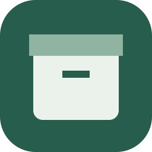
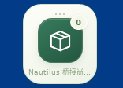
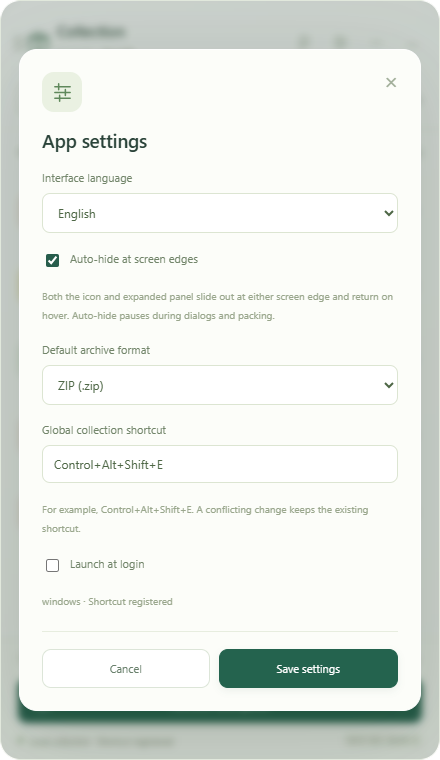
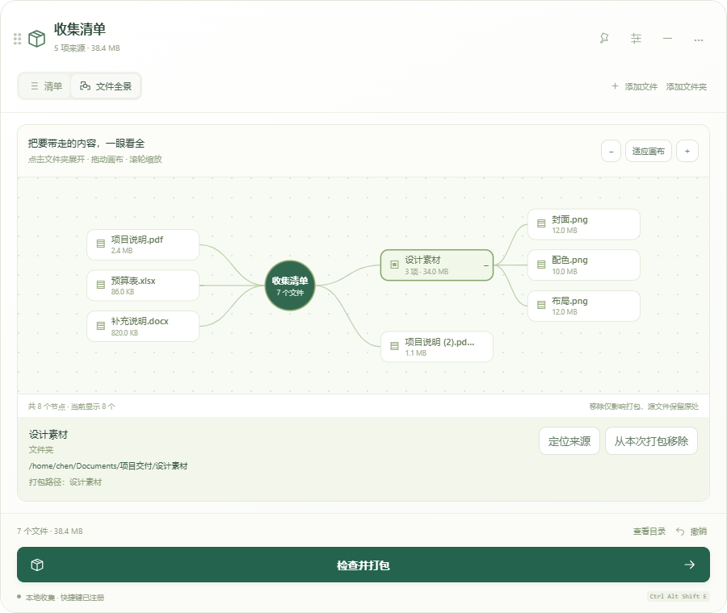

<p align="center">
  
</p>

# GatherPack

[简体中文](README.md) | **English**

[](https://github.com/dogchenya/GatherPack/actions/workflows/prototype.yml)
[](LICENSE)

**Collect scattered files. Pack them together.**

GatherPack is a desktop file collection and archiving tool for Windows, macOS, and Linux. Drop files and folders from different locations into a floating collection bar, organize the list, and export a ZIP, 7z, or tar.gz archive. Everything runs locally, without an account or network connection.

On first launch, GatherPack imports the collection, settings, and reports from an existing easy_pack profile while keeping the original data. If you use launch at login, re-enable it in Settings after migration. On macOS, grant Finder Automation permission when prompted.

## Latest features and how to use them

| Feature | How it works |
| --- | --- |
| Sliding edge hide | Move either the compact icon or expanded panel within about 32 pixels of any of the four screen edges. It slides out about 0.8 seconds after the pointer leaves, keeping only a wake-up tab (horizontal at top/bottom, vertical at left/right). Hover to slide back to the same view and dimensions; the expanded window remains resizable. Dialogs, file choosers and packing pause hiding. |
| Remove in the canvas | Select a file or folder in File graph and choose Remove from this archive, including nested items. Removing a folder excludes its subtree. Undo restores inclusion; original files stay in place. Exclusions are saved with the collection. Add the source again to restore inclusion. |
| Chinese / English | Choose Interface language in Settings for an immediate preview. Save to keep it after restarting, or cancel to restore the previous language. Simplified Chinese is the default. |
| Linux connection diagnostics | Open Local collection → Check file manager connection to inspect the resident Nautilus process, Python loader and desktop session. Checking closes no windows. |
| Linux reconnection | Finish copying or moving files, then choose Reconnect file manager and confirm. The app restarts the file manager with a clean Python environment and reloads its bridge. Other extensions are protected. Copy diagnostics if it still fails. |

Disable edge hiding in Settings if preferred; edge hiding works independently of keeping the window on top. A registered shortcut and a connected Nautilus extension are separate states. When the bridge is disconnected, use connection diagnostics instead of repeatedly installing dependencies that are already present.



*Native GNOME/X11 recording with an empty collection. The expanded panel also supports sliding edge hide. System reduced-motion preferences simplify animations.*


*1.0.0 production frontend with sample files. The app supports Simplified Chinese and English. Simplified Chinese is the default; switch languages in Settings.*



Windows no longer adds an extra native white frame. The area outside the rounded window stays transparent, and legacy user extensions shadowing the system Nautilus bridge are handled. If Ubuntu still reports a disconnected bridge after upgrading, use the checks and reconnection in Local collection. Finish file operations before confirming the extension reload.

Switching repeatedly between the collection and file graph preserves the current vertical position and custom window height.

The redesigned shelf adds undo, source relinking, window pinning, and continued collection during packing. See [UI and interaction notes](docs/ui-redesign.md).

Both the icon and expanded panel slide out at all four edges, including when partly dragged off-screen, and return on hover, independently of keeping the window on top. Linux provides resident process diagnostics and confirmed reconnection.



*1.0.0 production UI with sample files showing canvas removal.*

## Features

- **Collect across folders**: drag in files or entire folders, or capture the file manager's selection with a keyboard shortcut.
- **Floating collection bar**: drag the whole compact icon or expanded panel header. Both support sliding edge hide and return on hover; disable this in Settings if preferred.
- **Chinese and English**: Simplified Chinese by default; choose English in Settings and save it for future launches.
- **Three archive formats**: ZIP, 7z, and tar.gz, with a saved default and an override for individual tasks.
- **Preview before packing**: review the archive structure, renamed entries, and unavailable sources before starting.
- **File relationship graph**: expand folders, zoom or pan, reveal original locations, or remove selected nodes from the archive with undo support.
- **Preserve your originals**: collection stores paths; removing entries, clearing the list, or cancelling never deletes or moves source files.
- **Keep organizing**: background packing, progress and cancellation, result reports, and a collection that survives restarts.

Folders retain their structure, hidden contents, and empty directories. Duplicate names receive numbered suffixes. Unsupported entries, such as links, are listed for you to resolve or explicitly skip.

## Download and install

Stable versions use `vMAJOR.MINOR.PATCH` tags. Historical Alpha versions remain prereleases; prefer the stable release marked Latest. See [release and branch policy](docs/releasing.md).


Current version: **1.0.0**. This is the first stable release, with installers distributed through GitHub Releases. Use this version on Ubuntu 22.04; the alpha.4 Linux packages require GLIBC 2.39 and do not support 22.04.

Open [releases and downloads](https://github.com/dogchenya/GatherPack/releases/tag/v1.0.0), choose your platform under **Assets**, and install the package. No GitHub sign-in is required. Separate platform artifacts remain available in GitHub Actions.

| Platform | Artifact | Installation |
| --- | --- | --- |
| Windows x64 | [Windows x64 · EXE](https://github.com/dogchenya/GatherPack/releases/download/v1.0.0/gatherpack-1.0.0-x86_64-pc-windows-msvc-GatherPack_1.0.0_x64-setup.exe) | Run the `.exe` installer |
| macOS 14+ · Apple Silicon | [Apple Silicon · DMG](https://github.com/dogchenya/GatherPack/releases/download/v1.0.0/gatherpack-1.0.0-aarch64-apple-darwin-GatherPack_1.0.0_aarch64.dmg) | Open the `.dmg` and drag the app into Applications |
| macOS 14+ · Intel | [Intel · DMG](https://github.com/dogchenya/GatherPack/releases/download/v1.0.0/gatherpack-1.0.0-x86_64-apple-darwin-GatherPack_1.0.0_x64.dmg) | Open the `.dmg` and drag the app into Applications |
| Linux x86_64 · Ubuntu 22.04 / 24.04 | [Linux x86_64 · DEB](https://github.com/dogchenya/GatherPack/releases/download/v1.0.0/gatherpack-1.0.0-x86_64-unknown-linux-gnu-GatherPack_1.0.0_amd64.deb) | Install the `.deb` |
| Linux x86_64 · AppImage | [Linux x86_64 · AppImage](https://github.com/dogchenya/GatherPack/releases/download/v1.0.0/gatherpack-1.0.0-x86_64-unknown-linux-gnu-GatherPack_1.0.0_amd64.AppImage) | Make the `.AppImage` executable and run it |

Quit the previous GatherPack version before upgrading on Ubuntu. For a disconnected bridge, use the in-app connection diagnostics and confirmed reconnection. If it still fails, copy diagnostics and see [Nautilus shortcut troubleshooting](docs/nautilus-shortcut.md#english). The app never automatically interrupts file-manager operations and distinguishes missing dependencies from an installed but unloaded bridge.

Linux installers, corresponding source, and verification materials are separate downloads. For normal installation, choose either the `.deb` or AppImage. `x64`, `x86_64`, and `amd64` all mean 64-bit Intel/AMD; 32-bit x86 builds are currently unavailable.

The release includes a separate `corresponding-source.tar`; ordinary installation does not require it. Checksums are in `SHA256SUMS.txt`, with provenance and license notices provided separately. When redistributing an AppImage, also provide the corresponding source from the **same version and build**.

Installers are unsigned, and the macOS packages are not notarized. Linux shortcut integration has been validated with **GNOME / X11 / Nautilus**; see [Linux integration](docs/development.en.md#linux-integration) for initial setup.

See [UI and validation notes](docs/ui-redesign.md) for this release. Ubuntu GNOME/X11 covers actual drag/drop, collection shortcuts, native choosers, graph exploration, packing, and window movement. Full Windows/macOS file-manager interaction, Wayland, and other Linux file managers still need validation. Older evidence remains in the compatibility documentation.

## Getting started

1. **Collect**: start the app and drop files or folders onto the floating icon. You can also expand the panel and use “添加文件” (Add files) or “添加文件夹” (Add folder).
2. **Organize**: add items from other locations, remove unwanted entries, and inspect the output structure in “目录与问题” (Structure and issues).
3. **Pack**: select “检查并打包” (Review and pack), choose a format, destination, and filename, then resolve any reported issues before starting.
4. **Review**: read the result report or open the output folder. Your source files and collection remain available.

| Shortcut | Action |
| --- | --- |
| Windows / Linux: `Ctrl + Alt + Shift + E` | Collect the foreground file manager's selected items |
| macOS: `Command + Option + Shift + E` | Collect the selected items in Finder |

Settings controls the interface language, edge hiding, shortcut, default archive format and launch at login. Shortcut collection does not require copying files and does not read the clipboard. Diagnostic text is written to the clipboard only when you explicitly choose Copy diagnostics.

## Run from source

Built with **Tauri 2 · Rust · React · TypeScript**.

Install Rust **1.98.1**, Node.js **24**, pnpm **11.25.0**, and the [platform dependencies](docs/development.en.md#prerequisites), then run:

```sh
git clone https://github.com/dogchenya/GatherPack.git
cd GatherPack
pnpm install --frozen-lockfile
pnpm desktop:dev
```

See the [development guide](docs/development.en.md) for tests, installer builds, and Linux source builds.

## Contributing

Bug reports, suggestions, and Pull Requests are welcome. Open an [issue](https://github.com/dogchenya/GatherPack/issues) with your OS version, file manager, reproduction steps, and error message when reporting compatibility problems.

- [Development guide](docs/development.en.md)
- [Compatibility and validation record](docs/prototype-validation.md) (Chinese)
- [Third-party components and distribution notes](docs/third-party.md) (Chinese)

## License

Original GatherPack code is available under the [MIT License](LICENSE). Third-party components retain their own licenses; see [third-party notices](docs/THIRD_PARTY_NOTICES.md).
