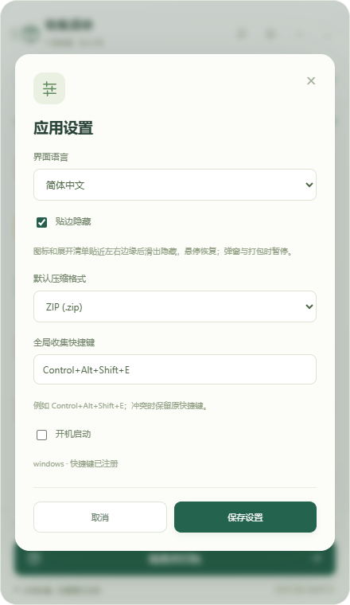

<p align="center">
  
</p>

# GatherPack

**简体中文** | [English](README.en.md)

[](https://github.com/dogchenya/GatherPack/actions/workflows/prototype.yml)
[](LICENSE)

**把分散的文件收集到一起，一次打包带走。**

GatherPack 是面向 Windows、macOS 和 Linux 的桌面文件收集与打包工具。把不同目录里的文件和文件夹拖进悬浮收集栏，整理好清单后，直接导出 ZIP、7z 或 tar.gz。整个过程在本机完成，无需账号或网络连接。

## 功能与使用方法

| 功能 | 使用方法 |
| --- | --- |
| 滑动贴边隐藏 | 把收起图标或展开清单拖到距离屏幕上下左右边缘约 32 像素以内，松开并移开鼠标约 0.8 秒后滑出隐藏，仅留唤回条（上下横条、左右竖条）；悬停滑回，保留原视图和窗口尺寸，展开窗口仍可正常调整大小。设置、文件选择和打包期间暂停隐藏。 |
| 画布移除 | 在文件全景中选中文件或文件夹，点击“从本次打包移除”；支持子项，移除文件夹会排除整个分支。点击“撤销”恢复；排除结果随清单保存，重新添加对应来源可恢复收集。源文件保留原处。 |
| 中文 / English | 在设置的“界面语言”中选择语言，即时预览；保存后重启沿用，取消恢复原语言。默认简体中文。 |
| Linux 连接检查 | 点击底部“本地收集”→“检查文件管理器连接”，查看当前 Nautilus 进程、Python 加载器与会话诊断。检查不会关闭窗口。 |
| Linux 一键重连 | 文件复制、移动结束后，在连接检查中点击“重新连接文件管理器”，确认后重启文件管理器并重新加载扩展。其他扩展文件不会被覆盖；若仍失败，可复制诊断信息继续排查。 |

贴边隐藏可在设置中关闭；贴边隐藏与置顶相互独立，取消置顶后仍可使用。快捷键注册成功与 Nautilus 扩展连接成功是两件事；出现“桥接未加载”时，请使用上述连接检查，不要反复安装已存在的依赖。


*GNOME/X11 原生窗口录屏，空清单演示。展开清单同样支持贴边滑动隐藏；系统开启减少动态效果时会简化动画。*


*1.0.0 正式前端，示例文件截图。应用默认简体中文，可在设置中切换 English。*



支持撤销整理、来源重新定位、窗口置顶及打包中的持续收集。

窗口圆角外保持透明。Ubuntu 如提示未连接，请使用“本地收集连接”中的检查与重连功能，先结束文件操作，再确认重新加载扩展。

反复切换清单与文件全景时，保留窗口当前位置和手动调整的高度。

图标和展开清单均支持四边贴边滑出、悬停滑回，部分拖出屏幕也可触发，隐藏与置顶相互独立；Linux 提供当前进程诊断和经确认后的连接修复。


*1.0.0 正式界面，使用示例文件展示画布移除入口。*

## 功能

- **跨目录收集**：拖入文件、整个文件夹，或通过快捷键收集文件管理器中的选中项。
- **轻量悬浮栏**：整块图标与展开后的标题栏均可拖动；图标和清单均支持上下左右贴边滑动隐藏、悬停恢复，可在设置中关闭。
- **中英双语**：默认简体中文，在设置中切换 English，保存后下次启动沿用。
- **三种压缩格式**：支持 ZIP、7z、tar.gz，保存默认格式，也可为单次任务临时切换。
- **打包前预览**：查看包内目录结构、重名处理结果和不可用来源，确认后再开始。
- **文件关系图**：展开文件夹分支、缩放和平移，定位来源，或选中节点从本次打包移除，支持撤销。
- **保留原文件**：收集阶段记录路径；移除、清空和取消操作不删除或移动源文件。
- **随时继续整理**：后台打包、进度与取消、结果报告、清单跨重启恢复。

文件夹会保留内部目录结构、隐藏内容和空文件夹。同名项目自动编号；链接等不支持的项目会列为问题，需处理或明确跳过。

## 下载与安装

当前稳定版本：**1.0.0**。安装包在 GitHub Releases 提供，Linux DEB 支持 Ubuntu 22.04 和 24.04。

打开 [发布与下载](https://github.com/dogchenya/GatherPack/releases/tag/v1.0.0)，在 **Assets** 中下载对应系统的安装包；无需登录 GitHub。GitHub Actions 仍保留按系统与架构分开的构建产物。

| 平台 | 下载项 | 安装方式 |
| --- | --- | --- |
| Windows x64 | [Windows x64 · EXE](https://github.com/dogchenya/GatherPack/releases/download/v1.0.0/gatherpack-1.0.0-x86_64-pc-windows-msvc-GatherPack_1.0.0_x64-setup.exe) | 运行 `.exe` 安装程序 |
| macOS 14+ · Apple Silicon | [Apple Silicon · DMG](https://github.com/dogchenya/GatherPack/releases/download/v1.0.0/gatherpack-1.0.0-aarch64-apple-darwin-GatherPack_1.0.0_aarch64.dmg) | 打开 `.dmg`，将应用拖入 Applications |
| macOS 14+ · Intel | [Intel · DMG](https://github.com/dogchenya/GatherPack/releases/download/v1.0.0/gatherpack-1.0.0-x86_64-apple-darwin-GatherPack_1.0.0_x64.dmg) | 打开 `.dmg`，将应用拖入 Applications |
| Linux x86_64 · Ubuntu 22.04 / 24.04 | [Linux x86_64 · DEB](https://github.com/dogchenya/GatherPack/releases/download/v1.0.0/gatherpack-1.0.0-x86_64-unknown-linux-gnu-GatherPack_1.0.0_amd64.deb) | 安装 `.deb` |
| Linux x86_64 · AppImage | [Linux x86_64 · AppImage](https://github.com/dogchenya/GatherPack/releases/download/v1.0.0/gatherpack-1.0.0-x86_64-unknown-linux-gnu-GatherPack_1.0.0_amd64.AppImage) | 赋予 `.AppImage` 执行权限后运行 |

安装前请先退出正在运行的 GatherPack。若快捷键提示桥接未加载，先使用应用中的连接检查与重连；未解决时复制诊断信息，并参考 [Nautilus 快捷键排查](docs/nautilus-shortcut.md)。应用不会自动中断文件管理器操作，也不会将已安装但尚未加载的依赖一律提示为缺失。

Linux 安装包、对应源码和校验材料分别下载，普通安装只需选择 `.deb` 或 AppImage 其中一种。`x64`、`x86_64`、`amd64` 均指 Intel/AMD 64 位架构，目前没有 32 位 x86 包。

对应源码为发布页中独立的 `corresponding-source.tar`，普通安装无需下载。校验和位于 `SHA256SUMS.txt`，构建来源及授权说明分别提供；Actions 中也保留分开的下载项。再分发 AppImage 时，须同时提供**同一版本、同一构建**的对应源码。

安装包尚未签名，macOS 包尚未公证。Linux 快捷键集成以 **GNOME / X11 / Nautilus** 为验证基线；首次启用步骤见 [Linux 集成说明](docs/development.md#linux-integration)。

Ubuntu GNOME/X11 已覆盖真实拖入、全局快捷键、文件选择、关系图、打包及窗口拖动；Windows/macOS 文件管理器完整桌面交互、Wayland 及其他 Linux 文件管理器仍待验证。

## 快速上手

1. **收集**：启动应用，把文件或文件夹拖到悬浮图标上；也可以展开面板，点击“添加文件”或“添加文件夹”。
2. **整理**：继续从其他目录添加，移除不需要的项目，在“目录与问题”中检查输出结构。
3. **打包**：点击“检查并打包”，选择格式、保存位置和包名，处理提示的问题后开始。
4. **查看结果**：完成后查看报告或打开输出目录。原文件和收集清单都会保留。

| 快捷键 | 操作 |
| --- | --- |
| Windows / Linux：`Ctrl + Alt + Shift + E` | 收集前台文件管理器中的选中项 |
| macOS：`Command + Option + Shift + E` | 收集 Finder 中的选中项 |

可在“设置”中修改界面语言、贴边隐藏、快捷键、默认格式和开机启动选项。快捷键收集无需先复制文件，不读取剪贴板；只有主动点击“复制诊断信息”才会将诊断内容写入剪贴板。

## 从源码运行

技术栈：**Tauri 2 · Rust · React · TypeScript**。

安装 Rust **1.98.1**、Node.js **24**、pnpm **11.25.0** 及[平台依赖](docs/development.md#prerequisites)，然后运行：

```sh
git clone https://github.com/dogchenya/GatherPack.git
cd GatherPack
pnpm install --frozen-lockfile
pnpm desktop:dev
```

测试、安装包构建和 Linux 自行编译步骤见 [开发指南](docs/development.md)。

## 参与贡献

欢迎通过 [Issues](https://github.com/dogchenya/GatherPack/issues) 反馈问题或建议，也欢迎提交 Pull Request。反馈兼容性问题时，请附上系统版本、文件管理器、复现步骤和错误信息。

- [开发指南](docs/development.md)
- [兼容性与验证记录](docs/prototype-validation.md)
- [第三方组件与分发说明](docs/third-party.md)

## 许可证

GatherPack 的原创代码使用 [MIT License](LICENSE)。第三方组件保留各自许可证，详见 [第三方声明](docs/THIRD_PARTY_NOTICES.md)。
