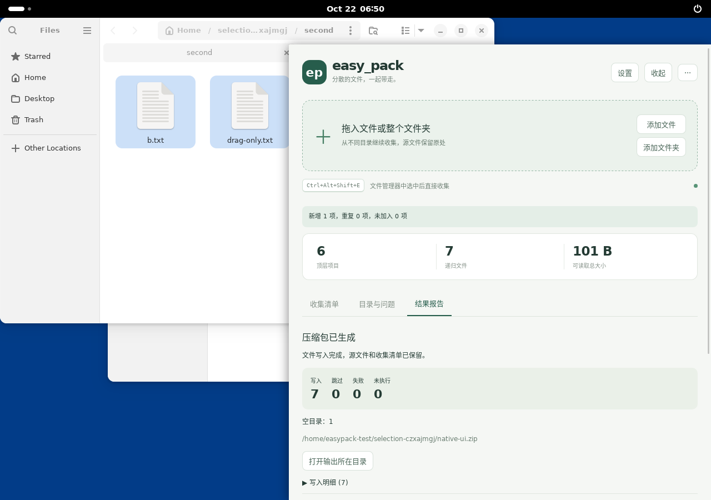

<p align="center">
  
</p>

# GatherPack

**简体中文** | [English](README.en.md)

[](https://github.com/dogchenya/GatherPack/actions/workflows/prototype.yml)
[](LICENSE)

**把分散的文件收集到一起，一次打包带走。**

GatherPack 是面向 Windows、macOS 和 Linux 的桌面文件收集与打包工具。把不同目录里的文件和文件夹拖进悬浮收集栏，整理好清单后，直接导出 ZIP、7z 或 tar.gz。整个过程在本机完成，无需账号或网络连接。

旧版 easy_pack 用户首次启动时会导入清单、设置和报告；旧记录保留。迁移后如需开机启动，请在设置中重新启用；macOS 请按系统提示授予 Finder 自动化权限。



*Linux/X11 界面示例。当前应用界面使用简体中文。*

## 功能

- **跨目录收集**：拖入文件、整个文件夹，或通过快捷键收集文件管理器中的选中项。
- **轻量悬浮栏**：收起时保留小图标，随时展开查看和管理清单。
- **三种压缩格式**：支持 ZIP、7z、tar.gz，保存默认格式，也可为单次任务临时切换。
- **打包前预览**：查看包内目录结构、重名处理结果和不可用来源，确认后再开始。
- **保留原文件**：收集阶段记录路径；移除、清空和取消操作不删除或移动源文件。
- **随时继续整理**：后台打包、进度与取消、结果报告、清单跨重启恢复。

文件夹会保留内部目录结构、隐藏内容和空文件夹。同名项目自动编号；链接等不支持的项目会列为问题，需处理或明确跳过。

## 下载与安装

当前版本：**0.1.0-alpha.4**，处于 Alpha 阶段，暂通过 GitHub Actions 提供安装包。

打开 [构建与下载](https://github.com/dogchenya/GatherPack/actions/runs/39760156652)，在 **Artifacts** 中下载对应系统的安装包，解压后安装。下载 Artifacts 需要登录 GitHub。

| 平台 | 下载项 | 安装方式 |
| --- | --- | --- |
| Windows x64 | `gatherpack-x86_64-pc-windows-msvc` | 运行 `.exe` 安装程序 |
| macOS 14+ · Apple Silicon | `gatherpack-aarch64-apple-darwin` | 打开 `.dmg`，将应用拖入 Applications |
| macOS 14+ · Intel | `gatherpack-x86_64-apple-darwin` | 打开 `.dmg`，将应用拖入 Applications |
| Linux x86_64 · Ubuntu 24.04 | `gatherpack-linux-x64-deb` | 约 5.3 MiB，安装 `.deb` |
| Linux x86_64 · AppImage | `gatherpack-linux-x64-appimage` | 约 80.6 MiB，赋予 `.AppImage` 执行权限后运行 |

Linux 安装包、对应源码和校验材料分别下载，普通安装只需选择 `.deb` 或 AppImage 其中一种。`x64`、`x86_64`、`amd64` 均指 Intel/AMD 64 位架构，目前没有 32 位 x86 包。

对应源码单独放在 `gatherpack-linux-x64-corresponding-source`（其中的 `.tar` 约 611 MiB）；SHA256 校验和、构建来源及授权说明放在 `gatherpack-linux-x64-checksums-and-licenses`。再分发 AppImage 时，须同时提供**同一轮下载**中的 `corresponding-source.tar`。

安装包尚未签名，macOS 包尚未公证。Linux 快捷键集成以 **GNOME / X11 / Nautilus** 为验证基线；首次启用步骤见 [Linux 集成说明](docs/development.md#linux-integration)。

四目标构建、真实 IPC、Windows 安装卸载、双架构 Mac 包内运行及 Linux 桌面流程已通过，证据见 [品牌迁移记录](docs/brand-migration.md)。Windows/macOS 文件管理器完整桌面交互、Wayland 及其他 Linux 文件管理器仍待验证，详见 [兼容性与验证记录](docs/prototype-validation.md)。

## 快速上手

1. **收集**：启动应用，把文件或文件夹拖到悬浮图标上；也可以展开面板，点击“添加文件”或“添加文件夹”。
2. **整理**：继续从其他目录添加，移除不需要的项目，在“目录与问题”中检查输出结构。
3. **打包**：点击“检查并打包”，选择格式、保存位置和包名，处理提示的问题后开始。
4. **查看结果**：完成后查看报告或打开输出目录。原文件和收集清单都会保留。

| 快捷键 | 操作 |
| --- | --- |
| Windows / Linux：`Ctrl + Alt + Shift + E` | 收集前台文件管理器中的选中项 |
| macOS：`Command + Option + Shift + E` | 收集 Finder 中的选中项 |

可在“设置”中修改快捷键、默认格式和开机启动选项。快捷键收集无需先复制文件，不读取剪贴板。

## 从源码运行

技术栈：**Tauri 2 · Rust · React · TypeScript**。

安装 Rust **1.98.1**、Node.js **24**、pnpm **11.25.0** 及[平台依赖](docs/development.md#prerequisites)，然后运行：

```sh
git clone https://github.com/dogchenya/GatherPack.git
cd GatherPack
pnpm install --frozen-lockfile
pnpm desktop:dev
```

测试、安装包构建和 Linux 自行编译步骤见 [开发指南](docs/development.md)。

## 参与贡献

欢迎通过 [Issues](https://github.com/dogchenya/GatherPack/issues) 反馈问题或建议，也欢迎提交 Pull Request。反馈兼容性问题时，请附上系统版本、文件管理器、复现步骤和错误信息。

- [开发指南](docs/development.md)
- [兼容性与验证记录](docs/prototype-validation.md)
- [第三方组件与分发说明](docs/third-party.md)

## 许可证

GatherPack 的原创代码使用 [MIT License](LICENSE)。第三方组件保留各自许可证，详见 [第三方声明](docs/THIRD_PARTY_NOTICES.md)。
